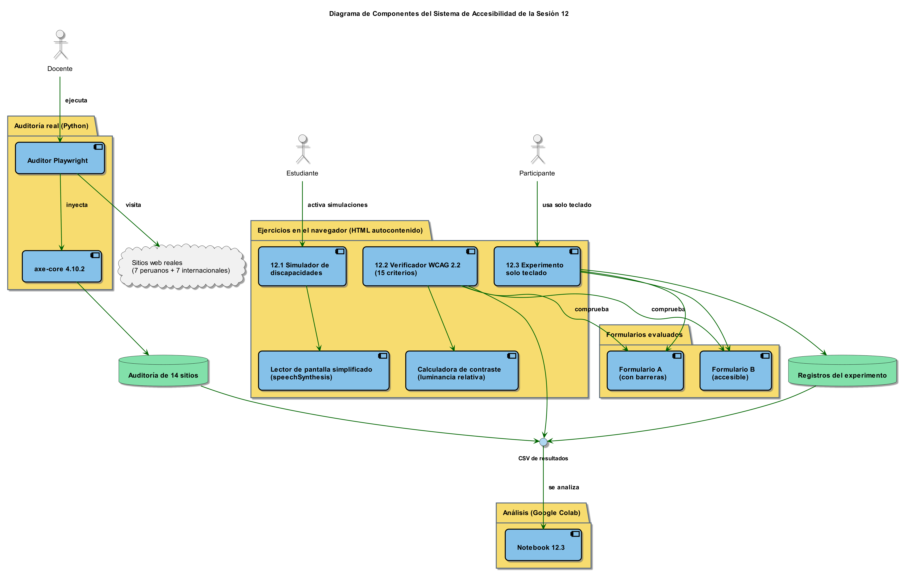
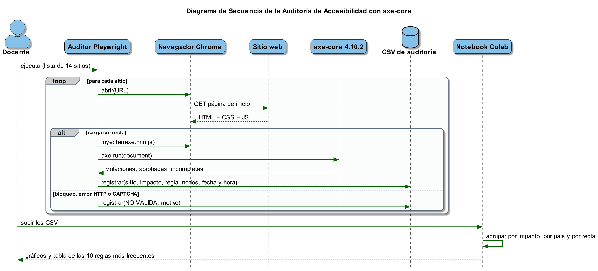
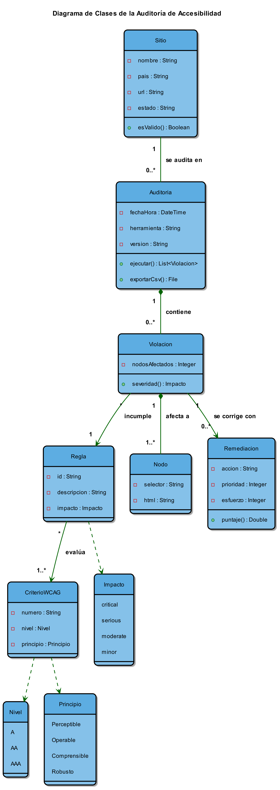
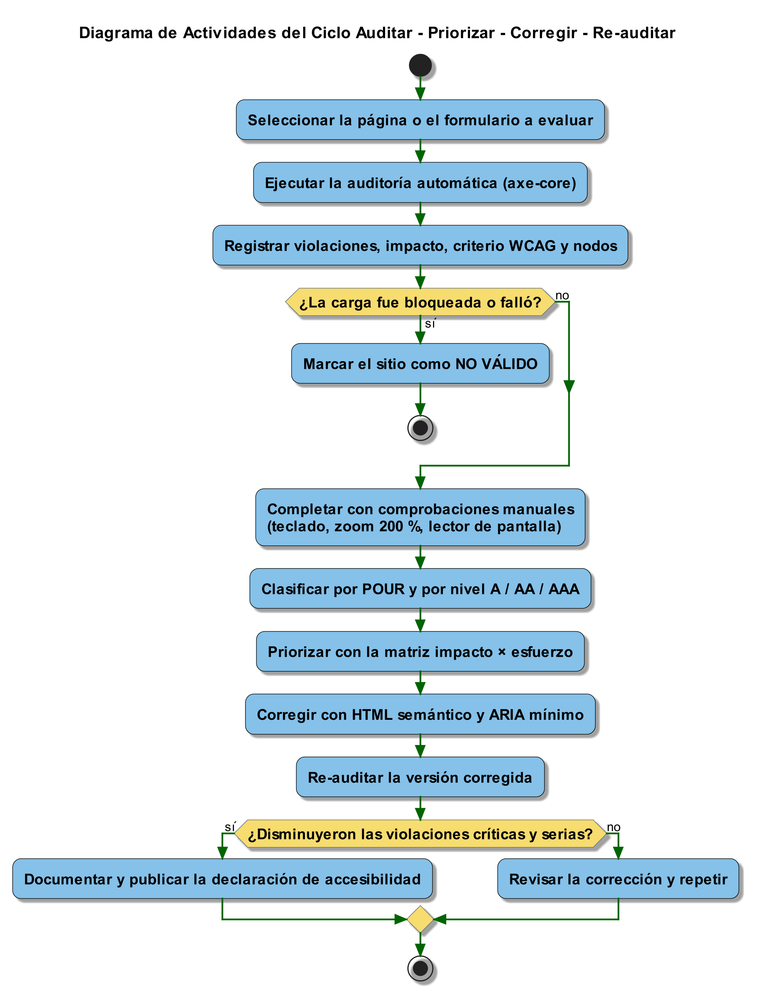
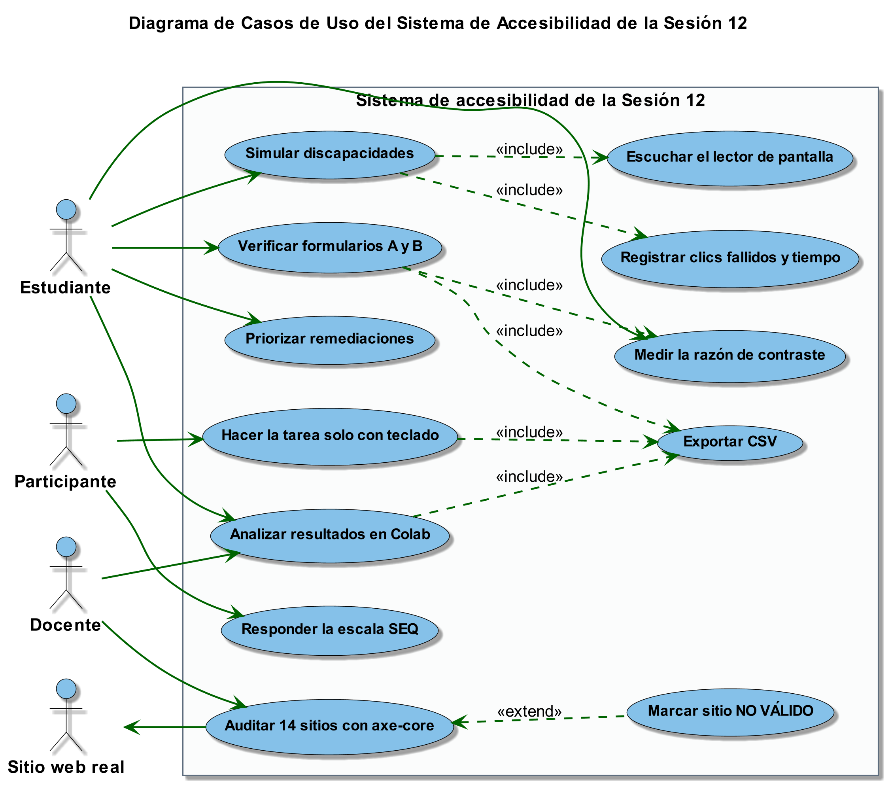

# Accesibilidad y diseño universal (WCAG 2.2) — Laboratorio 12 (IHC)

**ES** · Material práctico del Laboratorio del Tema 12 (Accesibilidad y diseño universal) del curso de Interacción Hombre-Computador: tres simuladores y verificadores en HTML + JavaScript, un notebook de Python que analiza una auditoría real hecha con axe-core 4.10.2 sobre 14 sitios, cinco diagramas UML y ocho prompts XML escritos en mi propio estilo **ESLBHP**.

**EN** · Hands-on material for Lab 12 (Accessibility and universal design) of the Human-Computer Interaction course: three HTML + JavaScript tools (disability simulator, WCAG checker, keyboard-only experiment), a Python notebook that analyses a real axe-core 4.10.2 audit of 14 websites, five UML diagrams and eight XML prompts written in my own **ESLBHP** style (Ernesto Style Label-Based HyperDetailed Prompts).

Material elaborado para el curso de IHC (202W0606) de la FISI-UNMSM (semestre 2026-II, Semana 12, Unidad IV), por Ernesto D. Cancho-Rodríguez.

## Contenido

| Carpeta | Qué contiene |
|---|---|
| [`html/`](html/) | Ejercicios 12.1 a 12.3: aplicaciones de un solo archivo, sin instalación ni servidor |
| [`notebooks/`](notebooks/) | Notebook del ejercicio 12.3 (ejecutado), su versión `.py` y un cuaderno de Colab para analizar los datos de la aplicación |
| [`datos/`](datos/) | Los dos CSV de la auditoría axe-core que lee el notebook |
| [`diagramas/`](diagramas/) | Cinco diagramas UML en PlantUML (`.puml`) y en imagen (`.png`) |
| [`prompts-eslbhp/`](prompts-eslbhp/) | Ocho prompts XML: fundamento y evidencia de la creación del lenguaje ESLBHP |

## Ejercicios HTML (`html/`)

Se abren con doble clic en cualquier navegador; son archivos únicos, sin instalación ni servidor.

**Pruébelos en línea (GitHub Pages):** [portada](https://mbaernestocr-tech.github.io/ihc-accesibilidad-wcag-lab12/) ·
[12.1 Simulador](https://mbaernestocr-tech.github.io/ihc-accesibilidad-wcag-lab12/html/ejercicio_12_1_simulador_discapacidades.html) ·
[12.2 Verificador WCAG](https://mbaernestocr-tech.github.io/ihc-accesibilidad-wcag-lab12/html/ejercicio_12_2_verificador_wcag.html) ·
[12.3 Experimento teclado](https://mbaernestocr-tech.github.io/ihc-accesibilidad-wcag-lab12/html/ejercicio_12_3_experimento_teclado_vs_raton.html)

| Archivo | Qué hace |
|---|---|
| `ejercicio_12_1_simulador_discapacidades.html` | Simulador de discapacidades y barreras de acceso: simulaciones elegibles, lector de pantalla simplificado, medición de una tarea y registro de intentos |
| `ejercicio_12_2_verificador_wcag.html` | Calculadora de contraste (criterios 1.4.3 y 1.4.11), verificador en vivo del formulario A (inaccesible) frente al B (accesible) y un fragmento para ejecutar en DevTools sobre cualquier sitio |
| `ejercicio_12_3_experimento_teclado_vs_raton.html` | Experimento «solo teclado» con los formularios A y B: tareas cronometradas, Single Ease Question (1 a 7) y resultados acumulados en el navegador |

## Notebooks (`notebooks/`)

| Archivo | Descripción |
|---|---|
| `ejercicio_12_3_analisis_accesibilidad.ipynb` | Tres fuentes: (A) auditoría real con axe-core sobre 14 sitios, (B) comprobaciones del verificador 12.2 sobre los formularios A y B, (C) experimento solo teclado 12.3 (contraste WCAG, prueba de Wilcoxon). Se entrega ejecutado. Si falta un CSV de las partes B o C, el notebook avisa y continúa sin inventar datos |
| `ejercicio_12_3_analisis_accesibilidad.py` | Las mismas celdas de código concatenadas |
| `S12_Analisis_Accesibilidad_Colab.ipynb` | Cuaderno de Colab que procesa los CSV de eventos y hallazgos exportados por la aplicación HTML de la sesión (esa aplicación no se incluye aquí): estadística descriptiva y matriz de prioridades |

La parte A del notebook 12.3 lee los CSV de [`datos/`](datos/), que deben estar en la misma carpeta que el notebook (cópielos junto a él o súbalos en Colab). Las partes B y C usan los CSV que exportan los ejercicios HTML 12.2 y 12.3 al usarlos; no se incluyen datos de participantes.

## Diagramas UML (`diagramas/`)

| Diagrama | Imagen | Código |
|---|---|---|
| Componentes | [PNG](diagramas/S12_UML_componentes.png) | [`.puml`](diagramas/S12_UML_componentes.puml) |
| Secuencia | [PNG](diagramas/S12_UML_secuencia.png) | [`.puml`](diagramas/S12_UML_secuencia.puml) |
| Clases | [PNG](diagramas/S12_UML_clases.png) | [`.puml`](diagramas/S12_UML_clases.puml) |
| Actividades | [PNG](diagramas/S12_UML_actividades.png) | [`.puml`](diagramas/S12_UML_actividades.puml) |
| Casos de uso | [PNG](diagramas/S12_UML_casos_uso.png) | [`.puml`](diagramas/S12_UML_casos_uso.puml) |











Para regenerar las imágenes desde el código: `plantuml -tpng diagramas/*.puml`.

## Prompts XML y el lenguaje ESLBHP (`prompts-eslbhp/`)

**ESLBHP** (*Ernesto Style Label-Based Hyperdetailed Prompts*) es un estilo propio de redacción de prompts: cada prompt es un bloque XML con etiquetas fijas (`<role>`, `<context>`, `<task>`, `<constraints>`, `<output>`, `<verification>`) que no dejan nada implícito. Estos ocho prompts son el fundamento y la evidencia de su creación aplicada al tema de accesibilidad. Todos comparten una regla ética: la IA genera **hipótesis**, no hallazgos validados; nada se da por cierto hasta que una persona o una herramienta lo compruebe en pantalla.

| ID | Prompt |
|---|---|
| P01 | Auditor WCAG 2.2 con evidencia obligatoria |
| P02 | Redactar texto alternativo (decorativa, informativa o funcional) |
| P03 | Reescribir un texto a lectura fácil |
| P04 | Corregir un formulario a HTML semántico accesible |
| P05 | Explicar un resultado de axe-core a una persona no experta |
| P06 | Persona ficticia con discapacidad para el diseño (con advertencia ética) |
| P07 | Redactar una declaración de accesibilidad |
| P08 | Plan de remediación priorizado |

Para usarlos, copie un `<prompt>` completo, con todas sus etiquetas, en el asistente de IA de su preferencia.

## Cómo ejecutarlo

```bash
git clone https://github.com/mbaernestocr-tech/ihc-accesibilidad-wcag-lab12.git
cd ihc-accesibilidad-wcag-lab12

python -m venv .venv && source .venv/bin/activate      # en Windows: .venv\Scripts\activate
pip install -r requirements.txt
cp datos/*.csv notebooks/                              # en Windows: copy datos\*.csv notebooks\
cd notebooks
jupyter lab
```

En Google Colab: abra el notebook y suba los dos CSV de `datos/` cuando lo pida la primera celda.

## Alcance y advertencias

- Material **educativo**. Nada de lo que contiene certifica la conformidad WCAG de un sitio: axe-core detecta aproximadamente entre el 30 y el 40 % de los problemas y no sustituye la evaluación manual, el uso de tecnologías de apoyo ni la participación de personas con discapacidad.
- Los resultados de la auditoría corresponden a una ejecución de axe-core 4.10.2 sobre sitios reales en una fecha dada; los sitios cambian y los resultados pueden variar.
- Parte del código y de los textos se elaboró con asistencia de IA generativa (Claude, de Anthropic); el autor revisó el contenido y responde por él.

## Licencia

© 2026 Ernesto D. Cancho-Rodríguez. Notebooks, código, diagramas y textos bajo [Creative Commons Atribución 4.0 Internacional (CC BY 4.0)](https://creativecommons.org/licenses/by/4.0/); el texto legal está en [`LICENSE`](LICENSE).
